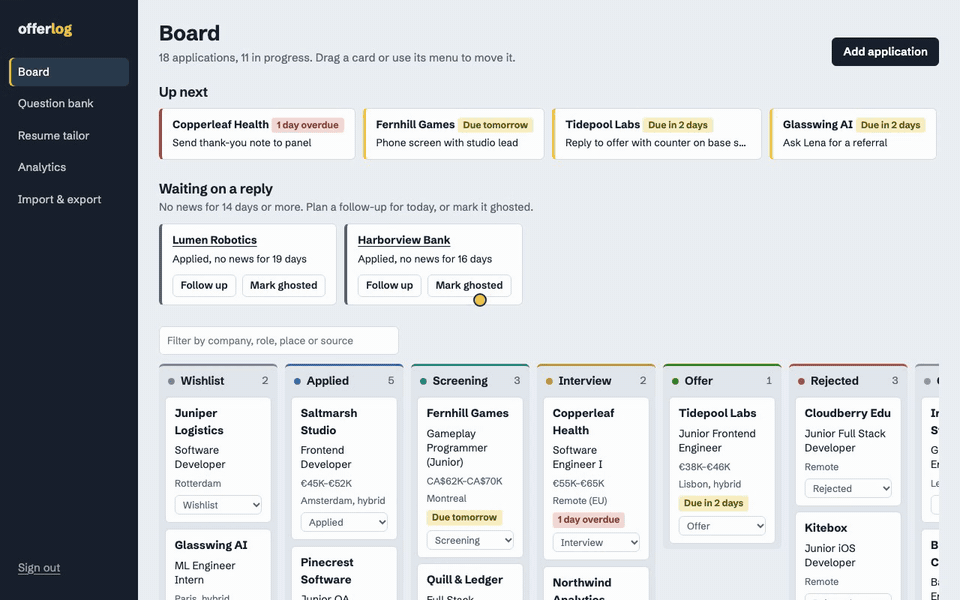
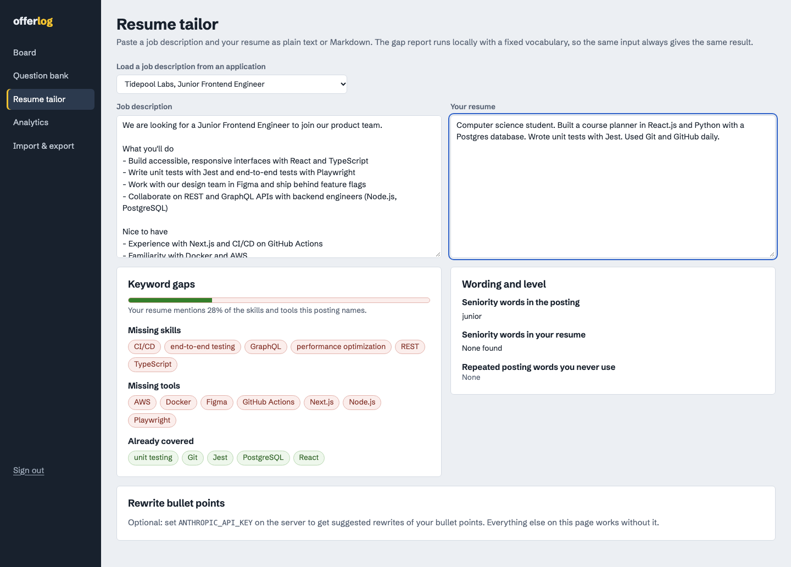
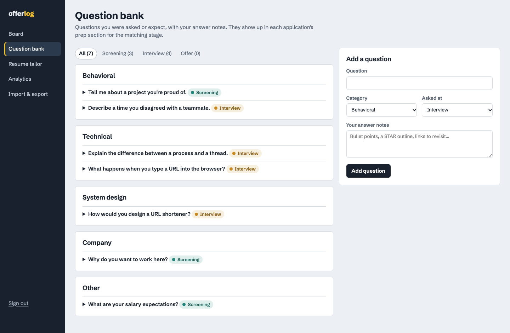
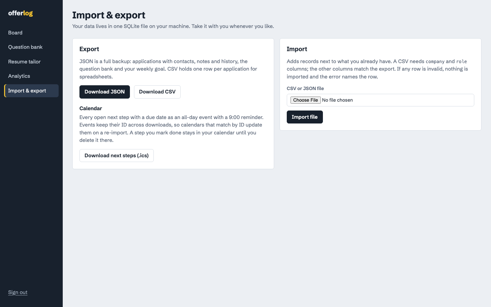
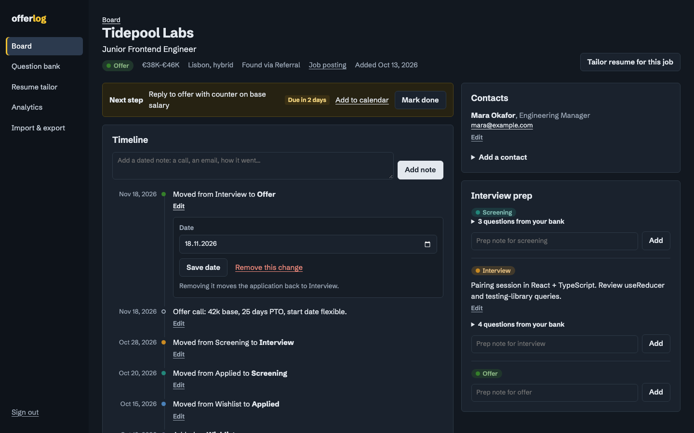
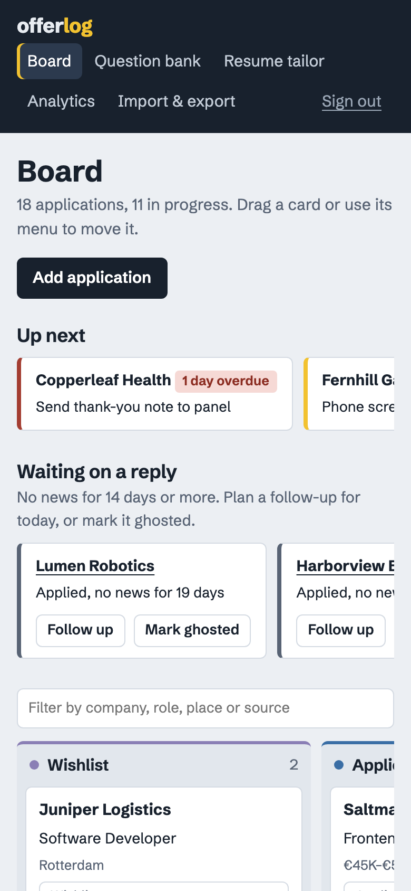
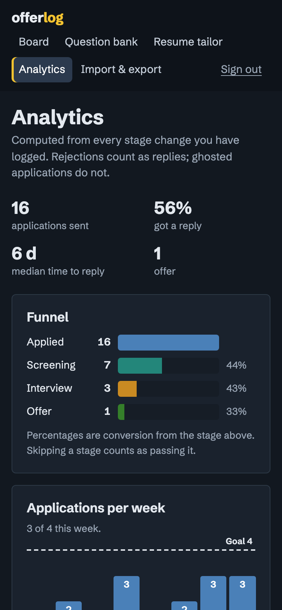

# offerlog

**A self-hosted job-search tracker for students and early-career developers: kanban, timeline, interview prep, resume keyword gaps and reply-rate analytics in one SQLite file.**

Track every application on a board, keep notes and interview prep in one place, check your resume against a posting without sending it anywhere, and see which channels actually get replies. No account and no cloud service: it runs on your machine, your tracker lives in one SQLite file, and the JSON export is a complete backup of it.



## Quickstart

Needs Node.js 22.18 or newer (the helper scripts are TypeScript files that Node runs directly).

```sh
git clone https://github.com/Habibeyilmazz/offerlog.git
cd offerlog
npm ci --ignore-scripts                       # SQLite driver ships prebuilt binaries; no compiler needed
node scripts/hash-password.ts >> .env.local   # asks for a password and saves only its hash
npm run build
npm start                                     # http://localhost:4220
```

Sign in with the password you chose. `npm start` listens on `127.0.0.1` only, because the app speaks plain HTTP; `npm start -- -H 0.0.0.0` opens it to your network, but a TLS reverse proxy is the safer way (see Docker below). On an empty board, **Load demo data** fills the tracker with fictional companies so you can look around (it is only offered while there are no applications and no questions, because it replaces both). `npm run db:seed` does the same from the command line and replaces everything.

### Docker

```sh
node scripts/hash-password.ts >> .env   # the script has no dependencies, so no npm install needed
docker compose up -d --build            # http://localhost:4220
```

Compose publishes the port on `127.0.0.1` only, because the app itself speaks plain HTTP. To open it from your phone or another machine, put a TLS reverse proxy (Caddy, nginx) in front of it rather than widening the port mapping. The database lives in the `offerlog-data` volume. No Node on the host? Run the script on any machine with Node 22.18+ and copy the printed `OFFERLOG_PASSWORD_HASH=...` line into `.env`.

### Configuration

| Variable | Required | What it does |
| --- | --- | --- |
| `OFFERLOG_PASSWORD_HASH` | yes | scrypt hash of the login password, from `node scripts/hash-password.ts`. Without it, login is refused. |
| `ANTHROPIC_API_KEY` | no | Turns on the AI bullet-point rewrite on the resume tailor page. Everything else works without it. |
| `OFFERLOG_DB` | no | Path of the SQLite file. Default `./data/offerlog.db` (`/data/offerlog.db` in Docker). |
| `OFFERLOG_SECURE_COOKIE` | no | `true` forces the `Secure` cookie flag. It is set automatically when a proxy sends `X-Forwarded-Proto: https`. |
| `TZ` | no | Time zone used for "due today", "overdue" and the Monday-to-Sunday weeks in analytics (Docker defaults to UTC). |

Behind a reverse proxy, forward the original `Host` (or `X-Forwarded-Host`) and `X-Forwarded-Proto` headers: Next.js compares them with the browser's `Origin` before running a form action, and the session cookie is marked `Secure` when the proxy reports HTTPS.

## Features

- **Board** with seven stages: wishlist, applied, screening, interview, offer, rejected, ghosted. Drag cards between columns, or use the stage menu on each card (works with keyboard and touch), and filter the board by company, role, place or source. An **Up next** strip lists next steps by due date and flags overdue ones.
- **Applications** with company, role, posting link, salary range and currency, location and work mode (onsite, hybrid, remote), source, job description, and a next step with a due date.
- **Timeline** per application: every stage change is recorded automatically, alongside your own dated notes. Marking a next step done logs it to the timeline. Notes can be edited in place and keep their original date.
- **Correct the history**: analytics are only as good as the dates behind them, so each stage change on the timeline can be moved to the day it really happened (a reply you logged three days late), or removed when it was a mistake (a card dropped in the wrong column, which would otherwise count as an offer in the funnel forever). Removing the latest change moves the application back to its previous stage. When you add an application you were already working on, give the day it reached its stage; in a CSV import, the `created_at` column does the same.
- **Contacts** per application (name, title, email, profile link), editable in place.
- **Interview prep** per stage (screening, interview, offer), with the matching questions from your **question bank** listed next to your notes.
- **Resume tailor**: paste a job description (or load one saved on an application) and your resume as plain text or Markdown. A local, deterministic report shows which skills and tools from the posting your resume covers or misses, seniority words on both sides, and repeated posting words you never use. With `ANTHROPIC_API_KEY` set, you can also ask Claude to rewrite specific bullet points toward the posting; it is told not to invent experience. Your resume text is remembered in this browser only (`localStorage`); it is not stored in the database or included in exports.
- **Analytics**: funnel with stage-to-stage conversion, response rate and median time to reply per source, and applications per week against a weekly goal you set.
- **Import and export**: full JSON backup and restore, and CSV for spreadsheets (comma or semicolon separated). Imports are validated and all-or-nothing.
- **Calendar export**: download your open next steps as an iCalendar (`.ics`) file from Import & export, or one next step with **Add to calendar** on its application, and import it into any calendar app that reads `.ics`. Each is an all-day event on its due date with a 9:00 reminder, the role and stage as its description and the posting link. Event IDs stay the same across downloads, so calendars that match events by ID update them on a re-import; a step marked done is not removed from your calendar. Steps on rejected or ghosted applications are left out.
- **Single-user login** with a hashed password, an HttpOnly session cookie and rate-limited sign-in.
- **Light and dark theme** following your system setting, a phone layout where board columns snap one at a time, keyboard access throughout (skip link, visible focus, a stage menu on every card, focus kept in place after a move or a save, moves announced to screen readers), and no animation when reduced motion is requested. The smoke test runs an axe-core WCAG 2.2 AA scan of every page in light, dark and phone width.

| Board | Application detail | Resume tailor |
| --- | --- | --- |
|  |  |  |

| Analytics | Question bank | Import & export |
| --- | --- | --- |
|  |  |  |

| Dark theme, redating a stage change | Board on a phone | Analytics on a phone, dark |
| --- | --- | --- |
|  |  |  |

## How it works

- **Stack**: Next.js App Router with server components and server actions, SQLite through Drizzle ORM and `better-sqlite3`. Migrations in `drizzle/` run automatically the first time the app opens the database.
- **Stage history is the source of truth.** Each stage change writes a row to `events`. An application counts as sent from its first move past wishlist (rejected and ghosted imply it was sent). The funnel counts the furthest stage each application reached, so skipping a stage counts as passing it. A reply is a move to screening, interview, offer or rejected; ghosted is not a reply. Time to reply is measured from the applied event, so an application logged straight into screening counts as replied but has no reply time. The weekly chart counts each application once, in the week it was sent. See `src/lib/analytics.ts`. Corrections keep the history consistent (`setEventDate` and `removeEvent` in `src/lib/data.ts`): a redated change cannot jump past its neighbours, and after a removal the following entries are re-linked and a move straight back is dropped too.
- **Keyword gaps** (`src/lib/keywords.ts`) match a curated vocabulary of about 120 skills and tools, with aliases (`k8s` counts as Kubernetes, `Postgres` as PostgreSQL) and symbol-aware word boundaries so `Java` does not match inside `JavaScript` and `C++`, `C#` and `.NET` work. No network call, no model: the same input always gives the same report.
- **AI rewrite** (`src/lib/ai.ts`) sends only the job description, the bullets you paste and the list of posting keywords your resume misses to the Anthropic Messages API (`claude-opus-5-5`, with server-side fallback on refusals). It only runs when you press the button and the key is set.
- **Security**: the password is checked against an scrypt hash with a constant-time compare. Sessions are random 256-bit tokens; only an HMAC of each, keyed by the password hash, is stored, so changing `OFFERLOG_PASSWORD_HASH` signs out every session. The cookie is HttpOnly and `SameSite=Lax`. Failed sign-ins are limited to 5 per client (keyed on the last `X-Forwarded-For` hop, the one your proxy adds) and 30 overall per 15 minutes. Every server action and route except sign-in and the health check checks the session, and every one validates its input; Next.js rejects server action requests whose `Origin` does not match the host. CSV exports neutralise spreadsheet formulas; exports, including calendar files, are sent with `Cache-Control: no-store`, and text in calendar files is escaped so it cannot add events or properties. Every response forbids framing and MIME sniffing. CI fails on a moderate or worse advisory in a runtime dependency.

## Development

```sh
npm run dev          # dev server on :4220 (set OFFERLOG_PASSWORD_HASH in .env.local first)
npm run typecheck
npm test             # unit tests (vitest)
npm run build && npm run test:e2e   # Playwright smoke test on :4222 with a throwaway database
npm run db:generate  # after changing src/db/schema.ts
```

The Playwright test uses Chromium; install it once with `npx playwright install chromium`.

README screenshots and the demo GIF come from a running instance seeded with `npm run db:seed`: `node scripts/screenshots.mjs http://localhost:4220 <password> docs/screenshots` and `node scripts/demo.mjs http://localhost:4220 <password> docs/demo.gif` (needs ffmpeg; it moves one demo card, so reseed afterwards).

## Compared with other options

offerlog is not the only way to track a job search, and often not the best one. An honest guide:

| You want | Use |
| --- | --- |
| Zero setup, sharing with a mentor or career office, your own columns | **A spreadsheet** (Google Sheets, Excel). offerlog's CSV export opens in either. |
| A board that syncs to your phone with no server to run | **Trello** or a **Notion** board. They are general-purpose, so stage history, reply rates and time to reply are up to you to keep by hand. |
| Saving postings from job boards in one click, plus hosted resume tools | **Huntr** or **Teal**: hosted job trackers with browser extensions. Your data lives in their service, under their account and pricing terms. |
| A detailed resume-to-posting match score | A dedicated scanner such as **Jobscan**. offerlog's tailor is a fixed vocabulary of about 120 skills and tools plus seniority words; it does not imitate an applicant tracking system. |

Pick offerlog when you want the data on your own machine, analytics computed from what actually happened (every stage change is dated and can be corrected), interview prep tied to each stage, and a resume check that never leaves your computer, and you are fine running a small Node or Docker app. What it does not have: a browser extension, email integration, a calendar that syncs by itself (next steps export as an `.ics` file), a mobile app (the web app works on phones), or more than one user.

## Contributing

Bug reports, ideas and pull requests are welcome. [CONTRIBUTING.md](CONTRIBUTING.md) covers setup, the checks CI runs and the conventions; the issue templates ask for steps against the demo data, never your real applications. To report a security problem, see [SECURITY.md](SECURITY.md) instead of opening a public issue.

## Roadmap

Not built yet:

- Saved filters and sorting options on the board (today: a quick text filter).
- A calendar subscription URL that stays in sync (today: download an `.ics` file and import it again after changes).
- A user-editable keyword vocabulary for the resume tailor.
- A manual light/dark switch (today the theme follows the system setting).
- Multiple users.

## License

[MIT](LICENSE)
