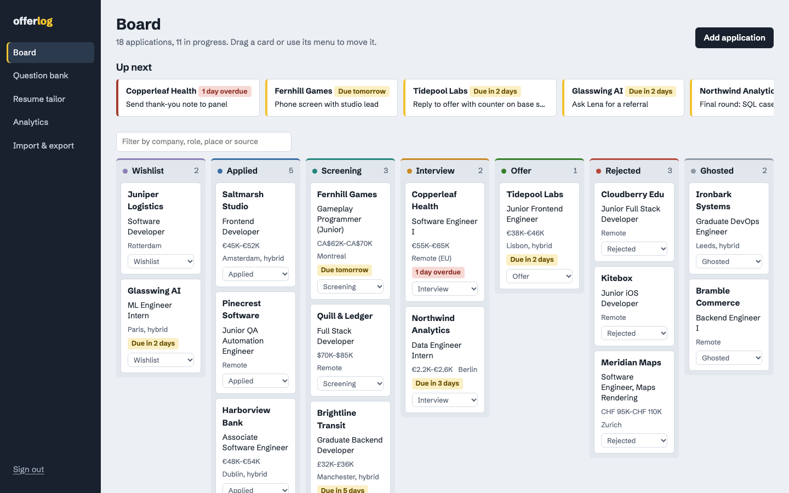
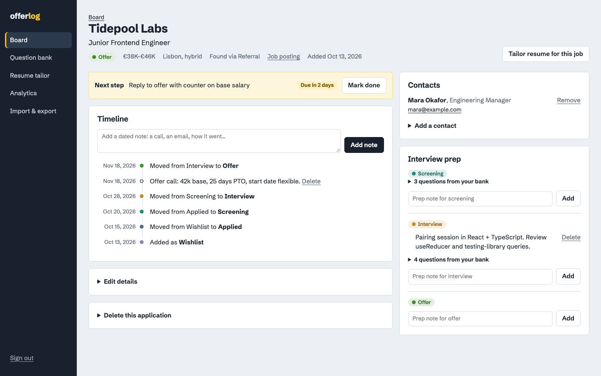
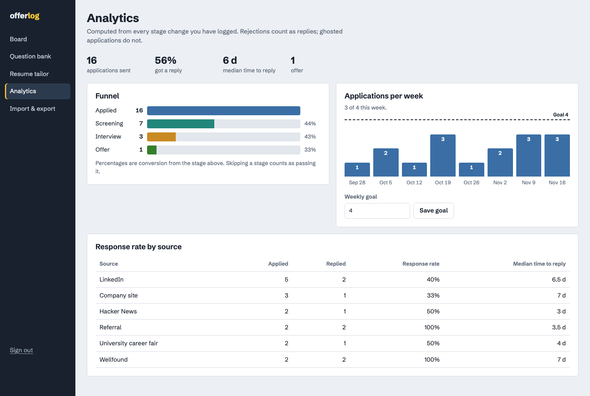

# offerlog

A self-hosted job-search command center for students and early-career developers.
Track every application on a kanban board, keep notes and interview prep in one place, check your resume against a posting, and see which channels actually get replies, all in a single SQLite file on your own machine.



## Quickstart

Needs Node.js 22 or newer.

```sh
git clone https://github.com/Habibeyilmazz/offerlog.git
cd offerlog
npm ci --ignore-scripts                       # SQLite driver ships prebuilt binaries; no compiler needed
node scripts/hash-password.ts >> .env.local   # asks for a password and saves only its hash
npm run build
npm start                                     # http://localhost:4220
```

Sign in with the password you chose. On an empty board, **Load demo data** fills the tracker with fictional companies so you can look around (it only works while the tracker is empty). `npm run db:seed` does the same from the command line and replaces everything.

### Docker

```sh
node scripts/hash-password.ts >> .env   # the script has no dependencies, so no npm install needed
docker compose up -d --build            # http://localhost:4220
```

The database lives in the `offerlog-data` volume. No Node on the host? Run the script on any machine with Node 22 and copy the printed `OFFERLOG_PASSWORD_HASH=...` line into `.env`.

### Configuration

| Variable | Required | What it does |
| --- | --- | --- |
| `OFFERLOG_PASSWORD_HASH` | yes | scrypt hash of the login password, from `node scripts/hash-password.ts`. Without it, login is refused. |
| `ANTHROPIC_API_KEY` | no | Turns on the AI bullet-point rewrite on the resume tailor page. Everything else works without it. |
| `OFFERLOG_DB` | no | Path of the SQLite file. Default `./data/offerlog.db` (`/data/offerlog.db` in Docker). |
| `OFFERLOG_SECURE_COOKIE` | no | `true` forces the `Secure` cookie flag. It is set automatically when a proxy sends `X-Forwarded-Proto: https`. |
| `TZ` | no | Time zone used for "due today" and "overdue" (Docker defaults to UTC). |

## Features

- **Board** with seven stages: wishlist, applied, screening, interview, offer, rejected, ghosted. Drag cards between columns, or use the stage menu on each card (works with keyboard and touch). An **Up next** strip lists next steps by due date and flags overdue ones.
- **Applications** with company, role, posting link, salary range and currency, location and work mode (onsite, hybrid, remote), source, job description, and a next step with a due date.
- **Timeline** per application: every stage change is recorded automatically, alongside your own dated notes. Marking a next step done logs it to the timeline.
- **Contacts** per application (name, title, email, profile link).
- **Interview prep** per stage (screening, interview, offer), with the matching questions from your **question bank** listed next to your notes.
- **Resume tailor**: paste a job description (or load one saved on an application) and your resume as plain text or Markdown. A local, deterministic report shows which skills and tools from the posting your resume covers or misses, seniority words on both sides, and repeated posting words you never use. With `ANTHROPIC_API_KEY` set, you can also ask Claude to rewrite specific bullet points toward the posting; it is told not to invent experience.
- **Analytics**: funnel with stage-to-stage conversion, response rate and median time to reply per source, and applications per week against a weekly goal you set.
- **Import and export**: full JSON backup and restore, and CSV for spreadsheets. Imports are validated and all-or-nothing.
- **Single-user login** with a hashed password, an HttpOnly session cookie and rate-limited sign-in.

| Application detail | Resume tailor | Analytics |
| --- | --- | --- |
|  |  |  |

## How it works

- **Stack**: Next.js App Router with server components and server actions, SQLite through Drizzle ORM and `better-sqlite3`. Migrations in `drizzle/` run automatically on startup.
- **Stage history is the source of truth.** Each stage change writes a row to `events`. The funnel counts the furthest stage each application reached (skipping a stage counts as passing it). A reply is the first move from applied to screening, interview, offer or rejected; ghosted is not a reply. Time to reply is measured from the applied event. See `src/lib/analytics.ts`.
- **Keyword gaps** (`src/lib/keywords.ts`) match a curated vocabulary of about 140 skills and tools, with aliases (`k8s` counts as Kubernetes, `Postgres` as PostgreSQL) and symbol-aware word boundaries so `Java` does not match inside `JavaScript` and `C++`, `C#` and `.NET` work. No network call, no model: the same input always gives the same report.
- **AI rewrite** (`src/lib/ai.ts`) sends only the job description and the bullets you paste to the Anthropic Messages API (`claude-opus-5-5`, with server-side fallback on refusals). It only runs when you press the button and the key is set.
- **Security**: the password is checked against an scrypt hash with a constant-time compare. Sessions are random 256-bit tokens; only their SHA-256 is stored, and the cookie is HttpOnly and `SameSite=Lax`. Failed sign-ins are limited to 5 per client and 30 overall per 15 minutes. Every server action and route checks the session and validates its input; Next.js rejects server action requests whose `Origin` does not match the host. CSV exports neutralise spreadsheet formulas.

## Development

```sh
npm run dev          # dev server on :4220 (set OFFERLOG_PASSWORD_HASH in .env.local first)
npm run typecheck
npm test             # unit tests (vitest)
npm run build && npm run test:e2e   # Playwright smoke test on :4222 with a throwaway database
npm run db:generate  # after changing src/db/schema.ts
```

The Playwright test uses Chromium; install it once with `npx playwright install chromium`.

## Roadmap

Not built yet:

- Free-text search and filters on the board.
- Calendar export (ICS) for next-step reminders and interviews.
- Editing a saved contact or note in place (today: delete and re-add).
- A user-editable keyword vocabulary for the resume tailor.
- Dark theme.
- Multiple users.

## License

[MIT](LICENSE)
